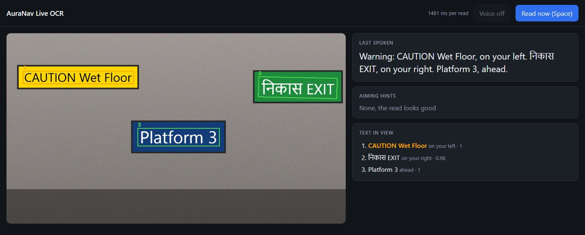
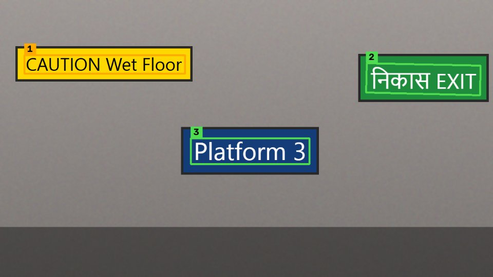
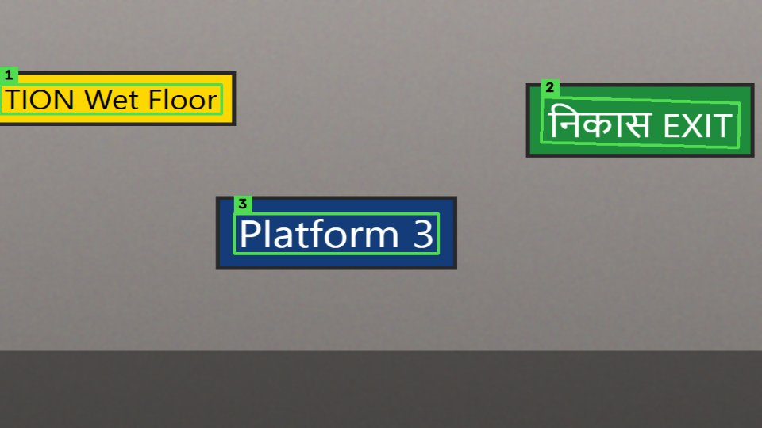
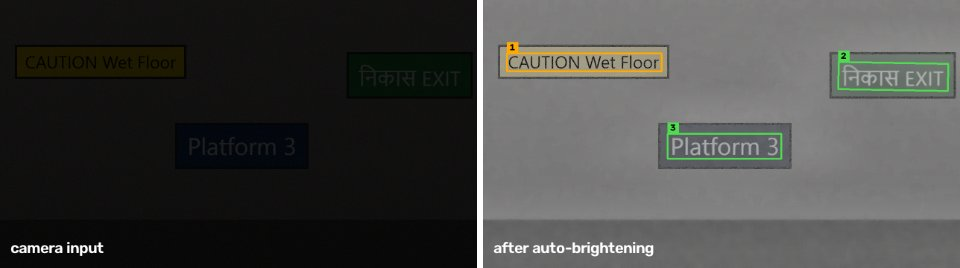
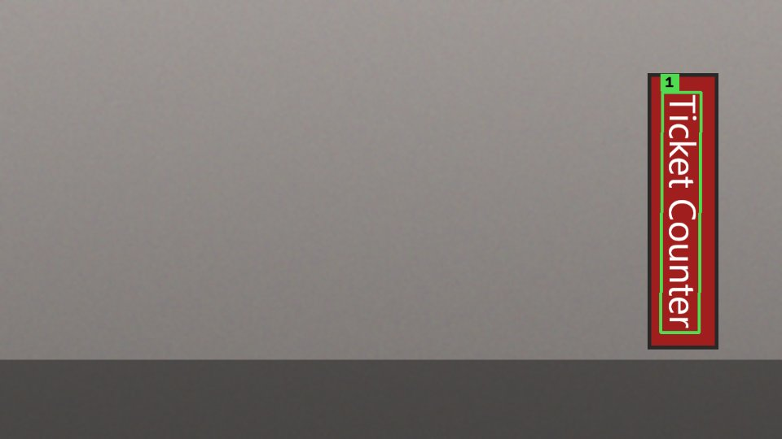
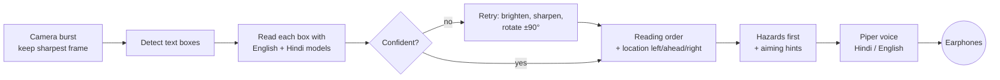

# AuraNav OCR

Offline sign reader for the AuraNav smart glasses, built for **blind and low-vision users**:
**camera frame → text → spoken sentence**, with where the text is and how to aim when the read is poor.

Runs fully on-device on a Raspberry Pi 5: [RapidOCR](https://github.com/RapidAI/RapidOCR) (PaddleOCR models on ONNX Runtime) for reading, [Piper](https://github.com/OHF-Voice/piper1-gpl) for the voice. No internet needed, and camera frames are never saved.

Reads **English**, **Hindi (Devanagari)** and **bilingual** signs (e.g. `निकास EXIT`).



## Examples

These are real outputs of the model. The scenes are synthetic, and the boxes and numbers are what it detected. **Amber** = hazard, **green** = other text.

| Camera frame | What the user hears |
|---|---|
|  | *"Warning: CAUTION Wet Floor, on your left. निकास EXIT, on your right. Platform 3, ahead."*<br><br>The hazard is said first, each sign gets its location, and the bilingual sign gets the Hindi voice for `निकास` and the English voice for `EXIT`. |
|  | *"TION Wet Floor, on your left. निकास EXIT, on your right. Platform 3, ahead. **Text cut off on the left, turn left.**"*<br><br>With half the word missing it can't tell this is a hazard, which is why the aiming hint matters. |
|  | *"Warning: CAUTION Wet Floor, on your left. निकास EXIT, on your right. Platform 3, ahead."*<br><br>At night the first pass is unsure, so it retries on an auto-brightened copy (right half) and reads everything. |
|  | *"Ticket Counter, on your right."*<br><br>Sideways text is read by the rotated retry pass. The box is mapped back so the location is still correct. |

## What the user hears

| Situation | Spoken |
|---|---|
| Sign read | `Warning: CAUTION, on your left. EXIT, on your right.` |
| Bilingual sign | `प्लेटफार्म 3 Platform 3, ahead.` (Hindi voice for the Hindi words, English voice for the rest) |
| Text runs off the frame | `Platform, on your left. Text cut off on the left, turn left.` |
| Dark scene | `No text found. Too dark.` |
| Blurry frame / far text | `… Image blurry, hold still.` / `… Move closer.` |
| Camera broken | `Camera not working.` |

Hazard words (`caution`, `danger`, `warning`, `fire`, `सावधान`, `खतरा`, …) are always said first, with `Warning:`. `STOP` on its own counts as a hazard; `Bus Stop` does not.

## Quick start

```bash
pip install -r requirements.txt
python -m piper.download_voices --data-dir voices en_US-lessac-medium hi_IN-priyamvada-medium

python ocr.py sign.jpg --speak     # read an image file aloud
python ocr.py --camera 0 --speak   # ENTER = read, q = quit
python ocr.py --auto 0 --speak     # hands-free: each new sign is announced once
python live.py                     # live webcam view in the browser: boxes, text, hints, voice
python test_ocr.py                 # self-check
python bench.py                    # hard-case accuracy/latency benchmark
```

The OCR models download on first run, then everything works offline. Leave out `--speak` to only print.

## Live view (for testing and demos)

```bash
python live.py                  # opens http://localhost:8000 in the browser
python live.py --camera 1       # another webcam
python live.py --no-speak       # silent, view only
python live.py --host 0.0.0.0   # on the Pi: watch the glasses' camera from a phone on the same Wi-Fi
```

This is the page in the screenshot at the top.

- **Left:** live webcam video with a numbered box around each piece of text. **Amber** = hazard (CAUTION, खतरा…), **green** = other text.
- **Right:** the last spoken sentence, aiming hints, and the list of text in view with location (left / ahead / right) and confidence.
- **Voice:** each new sign is spoken once, the same as hands-free mode. **Read now** (or **Space**) speaks everything in view plus the hints, like the glasses' button. **Mute** silences it.
- OCR runs in a background thread on the sharpest of the last 5 frames, so the video stays smooth.
- Stop it with **Ctrl+C** in the terminal; that also releases the webcam.

The page is for developers and sighted helpers; the blind user only hears the voice. It uses only the Python standard library (no web framework). `--host 0.0.0.0` shows the camera to everyone on that network, so use it only on a trusted one.

## Integrating it (for the app / trigger team)

The trigger (button, voice command, etc.) belongs to the app. This module gives you two objects:

```python
from ocr import OCR, Announcer, sharpest
from speech import Speaker

ocr, speaker = OCR(), Speaker()

# button press
speaker.beep("start")                 # confirm the press: a read takes ~1 s
res = ocr.describe(frame)             # Result(speech, lines, hints, hazard)
speaker.say(res.announcement)         # text, or "No text found.", plus aiming hints

# hands-free loop
announcer = Announcer()
text = announcer.filter(ocr.describe(frame, hints=False))
if text:
    speaker.say(text, wait=True)
```

- `Result.speech` is the sentence (hazards first, with locations). `Result.hints` holds the aiming hints, `Result.hazard` is true when a hazard was read, and `Result.lines` holds `Line(text, score, box)` in reading order, with boxes in original-frame pixels.
- `speaker.say()` interrupts anything already playing, so a new button press cuts off the old speech. `speaker.stop()` stops it outright.
- `sharpest(cap, burst=8)` grabs a burst from a `cv2.VideoCapture` and returns the sharpest frame, which handles head shake.

## How it works



1. **Detect** text boxes once. The detector input is capped at `max_side=960` px so wide camera frames stay fast on the Pi.
2. **Recognize** every box with both the English and the Devanagari model (batched). If the Hindi read contains Devanagari it wins, otherwise the English read is used. Picking by score fails: on `निकास EXIT` the English model confidently reads just `EXIT`.
3. **Retry only when unsure.** If nothing is found or the mean score is below `0.85`, the frame is retried brightened, sharpened and rotated ±90°, and the most confident pass wins. Boxes from rotated passes are mapped back to the original frame.
4. **Reading order:** boxes are grouped into rows, then sorted left to right.
5. **Location:** the box center's horizontal third gives `on your left` / `ahead` / `on your right` (the camera faces where the head faces).
6. **Aiming hints** come from simple checks: frame brightness (too dark), blur (Laplacian variance), boxes touching the frame border (cut off), small or low-confidence text (move closer).
7. **Auto mode** remembers what it said. The same sign (fuzzy match, since OCR output jitters between frames) isn't repeated for 30 s, or 10 s for hazards.
8. **Voice:** the sentence is split into Hindi and English runs, each synthesized with its own Piper voice, and the runs are joined into one clip. If a Piper voice is missing it falls back to `espeak-ng`; if that's missing too, the text is only printed.
   With `clone = "voice_ocr.mp3"` under `[speaker]`, both languages are spoken in the voice from that recording instead (XTTS-v2 voice cloning). Install it with `pip install coqui-tts torchcodec` (plus `torchaudio`). On the first run it downloads the model (~2 GB) and asks you to accept the [Coqui Public Model License](https://coqui.ai/cpml), which allows non-commercial use only. It takes a few seconds per sentence on a PC CPU and is too slow for the Pi. If it can't load, the Piper voices are used.

## Settings

All settings live in [config.toml](config.toml) and map 1:1 to the keyword arguments of `OCR`, `guidance`, `Speaker` and `Announcer`. The main ones:

| Setting | Default | Effect |
|---|---|---|
| `[ocr] min_score` | `0.6` | Raise if it reads noise; lower for blurry or far signs |
| `[ocr] max_side` | `960` | Bigger finds smaller/farther text, slower |
| `[ocr] hindi` | `true` | `false` = English-only, faster |
| `[ocr] locations` | `true` | Say left / ahead / right |
| `[guidance] dark, blur, edge, small` | see file | Aiming-hint thresholds. **Tune these on real glasses footage** |
| `[announcer] repeat_after, hazard_repeat` | `30`, `10` s | How soon a sign / hazard is repeated in auto mode |
| `[camera] burst` | `8` | Frames per read; more = steadier, slower |

## Running on the Raspberry Pi

```bash
sudo apt install alsa-utils fonts-dejavu fonts-liberation   # aplay for audio; fonts for bench.py
python3 -m venv .venv && .venv/bin/pip install -r requirements.txt
.venv/bin/python -m piper.download_voices --data-dir voices en_US-lessac-medium hi_IN-priyamvada-medium

# hands-free mode as a service: starts at boot, restarts on crash
sudo cp auranav-ocr.service /etc/systemd/system/ && sudo systemctl enable --now auranav-ocr
journalctl -u auranav-ocr -f
```

Edit `User` and the paths in [auranav-ocr.service](auranav-ocr.service) if the repo isn't at `/home/pi/ocr_model`.

## Privacy

- Everything runs on the device. Nothing is sent over the network after the first model download.
- Camera frames are never written to disk.
- At the default `INFO` level the logs record timing, line count, hazard flag and hints, **not the text read**, because users also read letters and medicine labels.

## Files

| File | Purpose |
|---|---|
| `ocr.py` | OCR, location, aiming hints, auto-mode `Announcer`, CLI |
| `live.py` | Live webcam viewer in the browser (http://localhost:8000): numbered boxes (amber = hazard), text, location, hints, spoken output; Space = read now |
| `speech.py` | `Speaker`: Piper TTS, Hindi/English routing, beeps, interruptible playback |
| `config.toml` | All settings |
| `test_ocr.py` | Assert-based self-check (reading order, hazards, location, hints, no-repeat, voice routing, Hindi) |
| `bench.py` | Synthetic benchmark: 14 hard cases (dark, glare, motion blur, tilt, tiny text, JPEG noise…) × English / Hindi / bilingual |
| `render_sign.py` | Renders Devanagari signs through headless Edge/Chrome (Pillow can't shape Devanagari without libraqm) |
| `bench_signs/` | Cached Hindi sign renders, so the tests and benchmark run without a browser |
| `auranav-ocr.service` | systemd unit for hands-free mode |
| `.github/workflows/test.yml` | CI: runs `test_ocr.py` on every push |
